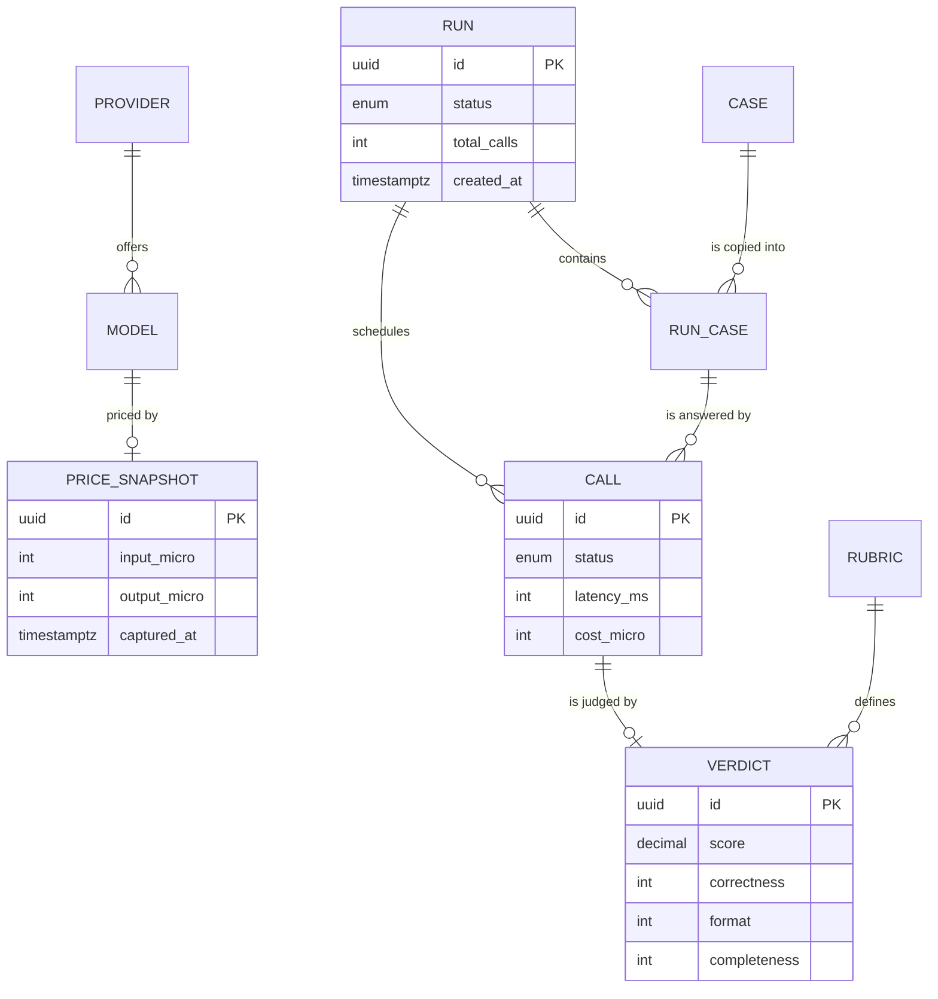
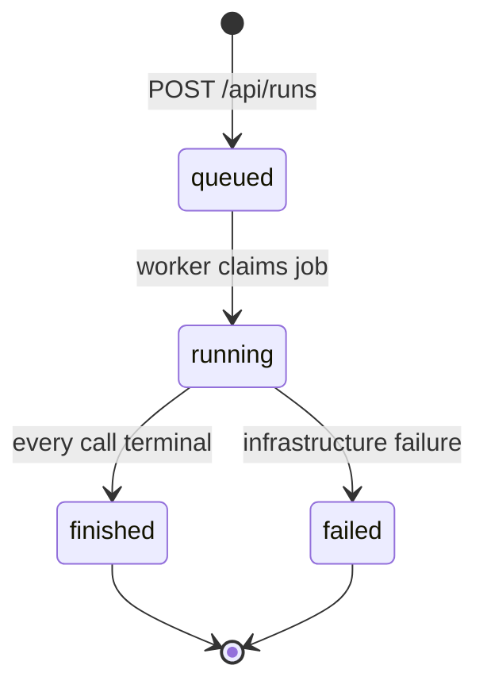
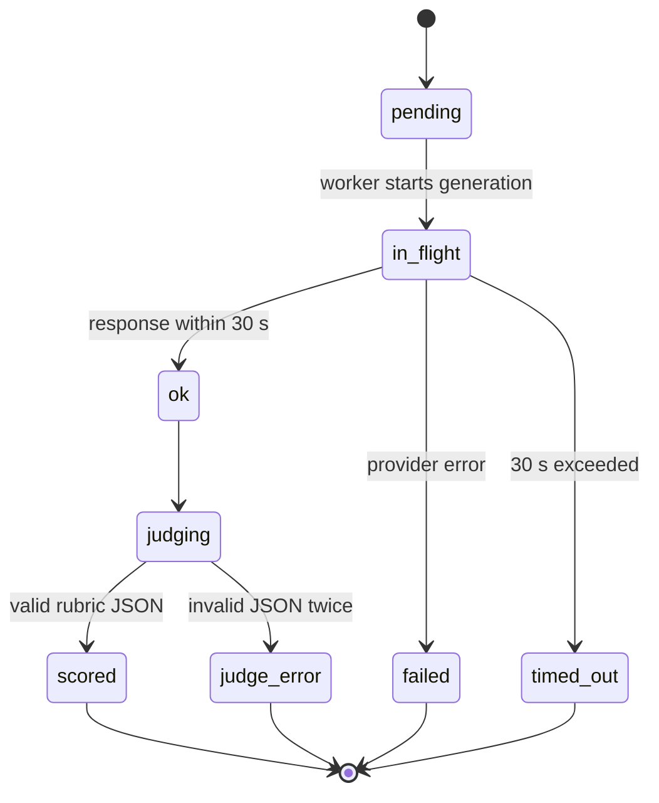
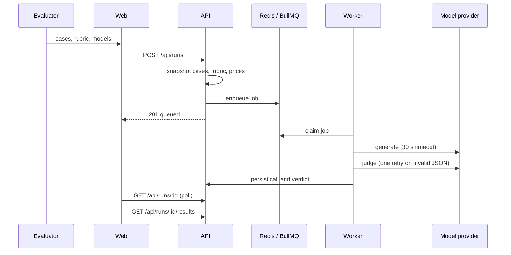

# 03 — Domain model and glossary: Mihak

**Rule:** the model says *what* and *why*; code says *how*. A twenty-line diagram here is worth a thousand lines of code when we are deciding what to build. Diagrams are written as Mermaid so they are stored in Git and reviewed like code.

---

## 1. Glossary — agreed terms and code names

The glossary is the bridge between the human language of the spec and the English identifiers in code. Use the code name verbatim; do not invent a synonym.

| Term | Agreed definition | Name in code |
|---|---|---|
| Case | One input with its expected answer and rubric reference; the unit of work | `Case` |
| Rubric | The three fixed dimensions used to judge an answer | `Rubric` |
| Run | An immutable snapshot of cases, rubric, models, and prices plus its calls | `Run` |
| Model | A named model offered by a provider, priceable in µUSD | `Model` |
| Provider | The adapter that can call a model; `fake` is the default | `Provider` |
| Price snapshot | The integer µUSD rates frozen when a run is created | `PriceSnapshot` |
| Call | One case × one model generation, with latency and cost | `Call` |
| Verdict | The judge's three dimensions, derived score, and explanation | `Verdict` |
| Score | The mean of available dimensions, rounded to one decimal, in 1–5 | `score` |
| Rank | Position in the comparison table; `null` when data is insufficient | `rank` |

Five to eight terms is the workshop target; the domain here needs ten because pricing and judging are separate concepts. Every term above is used by at least one story in `docs/02-spec.md`.

## 2. Entity–relationship diagram

## 3. Lifecycle of a Run

`finished` does **not** mean every call succeeded. `failed`, `timed_out`, and `judge_error` are terminal call states and the run still finishes. Only an infrastructure failure fails the whole run.

## 4. Lifecycle of a Call

Forbidden transition: `timed_out → in_flight`. Retries are out of scope for v0.1.

## 5. Sequence for the main story

Domain events, past tense: **RunCreated** · **JobClaimed** · **GenerationSucceeded** · **GenerationTimedOut** · **VerdictRecorded** · **RunFinished**. For each event: the cause is in the sequence diagram, the rule is in §6, and the follow-up is in the API contract.

## 6. Invariants and where they are enforced

Every invariant becomes a constraint in the database, a validation in code, a test, or a line in `AGENTS.md`. "Every arrow that is missing is a rule, and every rule is a test."

| Invariant | Enforcement |
|---|---|
| A run has at least two models | API validation → `no_models` |
| Every selected model has an active price before the run is queued | API validation → `missing_price` |
| A price snapshot never changes after a run is created | Prisma schema + `run_immutable` |
| `score` is 1–5, mean of available dimensions, one decimal | Zod schema + scoring test |
| A missing dimension stays `null`; no default of 3 | Zod schema + parser test |
| Costs are integer µUSD, one rounding step at the call level | Zod schema + cost test |
| A call never exceeds 30 seconds and is never retried | Worker adapter config |
| Invalid judge JSON is retried once, then `judge_error` | Worker + test |
| A terminal run is never edited | API → `run_immutable` |
| All timestamps are UTC; locale and numbering system chosen at display time | Shared formatter |

## 7. Consistency matrix — story × entity

`C` create · `R` read · `U` update · `D` delete · blank = not touched.

| Story | Case | Rubric | Run | Call | Verdict | PriceSnapshot | Provider |
|---|---|---|---|---|---|---|---|
| ST-1 | C | R | | | | | |
| ST-2 | R | | C/R | C/R | | R | R |
| ST-3 | R | R | | U | C | | |
| ST-4 | R | R | R | R | R | R | |
| ST-5 | R | R | | R | R | | |

No entity is untouched by every story, and no story touches nothing. If a future story breaks either rule, either the entity is unnecessary or the story is too vague.

## 8. Error checklist for a generated model

Before accepting a model draft, check:

- [x] No single generic entity pretending to cover every role.
- [x] No redundant relation creating two copies of the same truth (`PriceSnapshot` is frozen, not derived live).
- [x] No wrong multiplicity: one `Verdict` per `Call`, not many.
- [x] No missing invariant: unique price snapshot per run, explicit terminal states.
- [x] History is kept: `createdAt`, `capturedAt`, terminal call state.
- [x] No UI property leaked into the domain: no `selected`, `drawerOpen`, or CSS class here.

**Engineer decides:** what deserves to be an entity, the boundary of each concept, the real states and allowed transitions, where each invariant is enforced, and what history we keep. The agent drafts; it does not decide.
