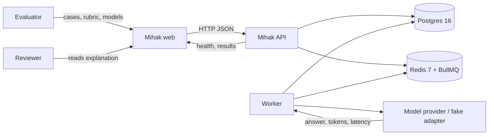
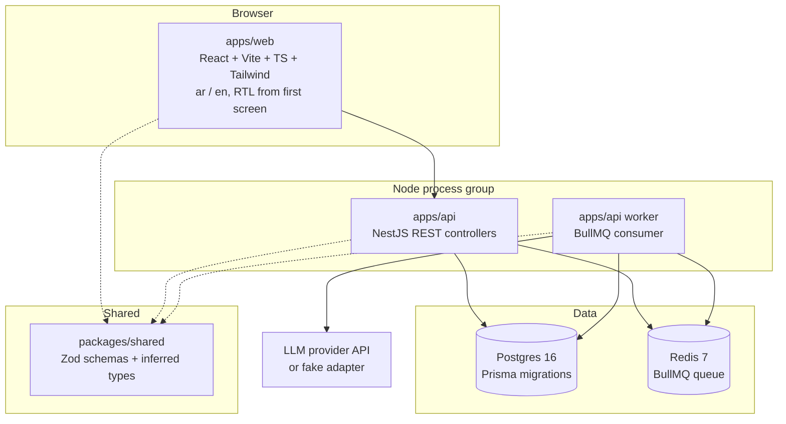

# 04 — Architecture: context and containers

Only levels 1 and 2 of the four C4 levels are drawn today: **context** (system and its neighbours) and **containers** (what is deployed). Components and code are drawn later, when a story needs them. Diagrams are Mermaid so they live in Git and can be reviewed.

---

## 1. Quality attributes that drive the design

The top three measurable requirements from `docs/02-spec.md` §5:

| Attribute | Measurable requirement | Architectural effect |
|---|---|---|
| Cost accuracy | 100% of displayed costs equal the integer µUSD snapshot | Price capture happens once at run creation; no live price lookup during display |
| Responsiveness | Results API p95 < 500 ms at 2 models × 20 cases | Results are pre-aggregated and read from Postgres; the polling endpoint is one row plus counts |
| Bilingual completeness | 100% of strings in `ar` and `en`, placeholders equal | Locale resources are shared by web and API; a check gate runs on every PR |

Trade-offs accepted: simplicity over horizontal scaling, consistency over availability for run state, and fast delivery over perfect abstraction. A pattern without a problem it solves is free complexity.

## 2. System context

The evaluator never talks to a model provider directly. The provider is behind one port, with a fake adapter as the default in tests and demos.

## 3. Containers

`pnpm dev` starts web, API, and worker together against Docker Postgres and Redis. One repository, one deployable API, one database — a **modular monolith** with a queue, not microservices. See [`docs/adr/0001-modular-monolith-and-frozen-contract.md`](adr/0001-modular-monolith-and-frozen-contract.md).

## 4. Module boundaries

| Container | Public surface | Rule |
|---|---|---|
| `packages/shared` | Zod schemas, inferred types, error codes | No runtime logic, no framework imports; it is the frozen contract |
| `apps/api` — catalog & runs | `/api/catalog`, `/api/runs*` | Controllers translate HTTP; they do not contain domain rules |
| `apps/api` — judge | rubric presets, verdict parsing | Judge output is validated with Zod; invalid JSON becomes a value, not an exception |
| `apps/api` — worker | job claim, execution, recovery | Generation and judging call provider ports; adapters own HTTP, clock, and retries policy |
| `apps/web` | input, status, results, drawer | Screens consume the shared types; no string literal is user-visible |

A module imports another module only through its public entry point. Domain code never reads the clock, the network, or the database directly; they are injected. These rules are copied into `AGENTS.md` so every agent session sees them.

## 5. Pattern choices

| Pattern | Where | Why |
|---|---|---|
| Ports and adapters | Provider, clock, price lookup | Swap the fake adapter for a real provider without touching domain logic |
| Repository | Postgres access | One place for queries; testable worker without a database |
| Strategy | Rubric presets and judge prompt | One interface, several rubrics |
| Dependency injection | Clock and provider | Freezes "now" in tests; deterministic cost calculation |
| Domain events (past tense) | Run and call lifecycle | Explains what happened without exposing implementation |

No event bus between modules, no service mesh, no serverless functions. Those patterns have no problem to solve in a 96-hour solo build.

## 6. Consequences

**Positive:** one local command, one database, one contract shared by three processes; a fake adapter keeps CI deterministic; the frozen Zod schema stops the classic "frontend drifted from backend" failure.

**Negative:** the worker and API share a process group, so a bad deployment takes both down; a modular monolith needs discipline to keep imports clean; the results table is pre-aggregated, so a new column means a migration plus a contract PR. These costs are accepted for v0.1 and recorded in the ADR.

## 7. What is deliberately not drawn

Component and code-level diagrams, deployment topology beyond staging, and a data-flow diagram for real provider keys. They are added when a story in S4 or S5 needs a decision that the container view cannot answer.
